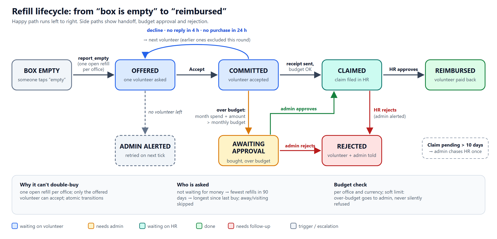

# Snack Counter Automation: Design

Two offices, each with its own snack counter and budget: Oslo (NOK, 6 000/month, about 15 volunteers) and Bengaluru (INR, 15 000/month, about 20 volunteers).

## What "automate" means
Replace "everyone assumes someone else will do it" with **one named person at a time, with a deadline**. A bot in the existing chat tool asks a volunteer, moves on if they don't answer, and files the HR claim for them. The volunteer taps *Accept*, buys, and sends the receipt photo and amount.

## Lifecycle: empty to reimbursed

1. Anyone presses "box is empty". This creates a refill, or returns the open one.
2. The bot offers it to one volunteer (4 h to answer). On *Accept* they have 24 h to submit the receipt.
3. Decline, silence or a missed purchase deadline hands it to the next volunteer. If nobody is left, the office admin is told once and a new round starts.
4. On receipt the budget check runs. If it passes, the bot creates the HR claim (amount, currency, description, receipt, employee ID).
5. A periodic job polls HR. Approved claims become REIMBURSED. Rejected ones alert the admin. Claims pending over 10 days (HR's maximum) alert the admin once.

## Parts and their data
| Part | Owns |
|---|---|
| Refill service (`src/SnackCounter/SnackService.cs`) | Refills: office, state, assignee, buyer, deadline, excluded volunteers, amount, items, claim ID, audit log. Only writer of state. |
| Directory | Employees, volunteer roster per office, visits, away periods. Synced from company login and chat status. |
| Chat adapter | `send(user, text)` plus Accept/Decline/Receipt callbacks. No business state. |
| HR adapter | Idempotent `create_claim` and `get_status`. We keep only the claim ID. |
| Budget and report | Derived from refills (no separate ledger to drift). Fixed finance-set FX rate, used only for the report. |

## How the problems are prevented
- **Empty for days:** exactly one person is responsible at a time, and silence triggers a handoff, not a wait.
- **Double buying:** at most one open refill per office, and only the person currently offered it can accept. Transitions are atomic, so a second accept fails (tested with threads). In production: a DB transaction plus a unique partial index on open refills per office.
- **Overloaded few, slow payback:** candidates are ranked by (1) not waiting for a reimbursement, (2) fewest refills in 90 days, (3) longest since last purchase. Overdue claims are chased automatically.
- **No visibility:** every purchase is stored with amount, currency and items. One monthly report gives spend vs budget per office in its own currency, a combined NOK total, and top items.
- **Visitors and hybrid work:** eligibility uses the person's *current* office, and away status is respected. Visitors can opt into the host roster. Hybrid days are covered by the short offer window and *Decline*.
- **Currency:** claims use the currency of the office where the purchase happened and HR converts to payroll currency. Budgets are checked per office and currency.

## Budget check
At receipt time: `spent this month (non-rejected) + amount <= monthly budget`. If it passes, the claim is filed at once. If not, the refill waits for admin approval. It is a **soft limit**: the volunteer has already paid, so the system flags and escalates but never silently refuses. Amounts use `decimal`, and exactly on budget passes.

## Trade-offs
- **One person at a time, not a broadcast:** slower per hop, but double buying becomes impossible and load is spread fairly.
- **Budget checked after purchase:** one purchase can overshoot, but nobody is left unreimbursed.
- **Derived totals, no ledger:** always consistent, and cheap at about 10 refills a month.
- **Polling HR:** we do not control that system, so webhooks are not an option.

## Deliberately not built
Receipt OCR (HR owns that control), stock forecasting or ordering integrations, a web UI, calendar or badge presence detection, automatic FX lookups (finance sets the rate so reports are reproducible), and payment tracking beyond HR's status.

## Code and tests
`src/SnackCounter/SnackService.cs` has the logic and `Fakes.cs` the simulated chat, HR and clock. The 29 tests (`dotnet test`) cover single commit, concurrency, handoff, fair choice, visitors, per-currency budgets, month rollover, report totals, idempotent claims and HR rejection or delay.
